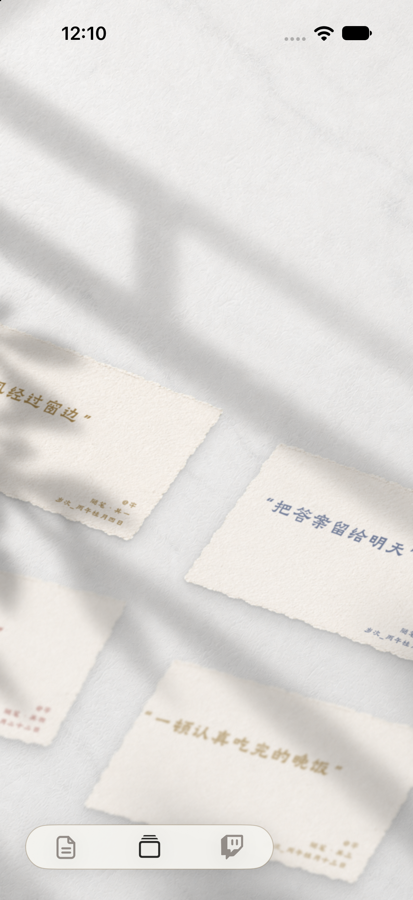
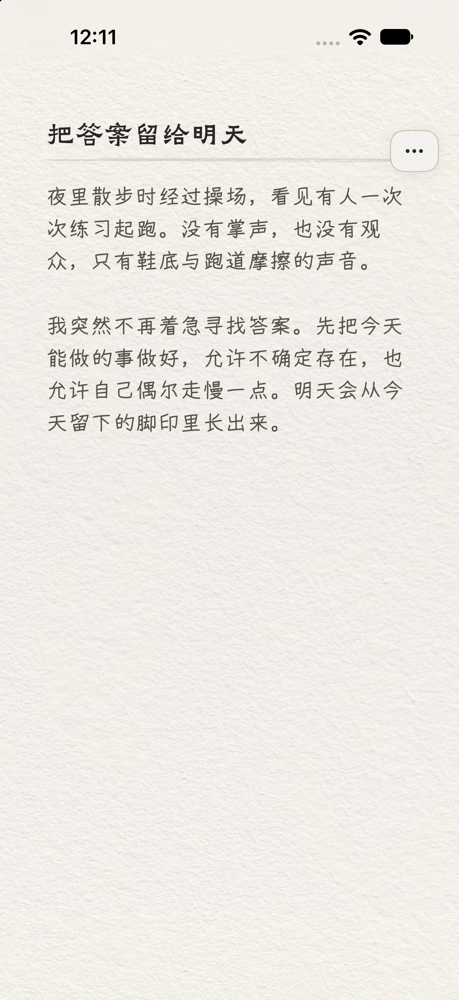
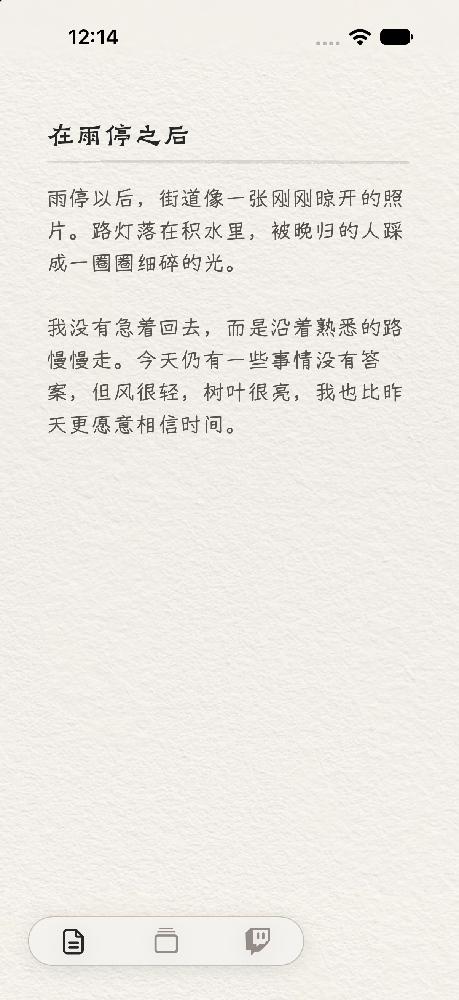
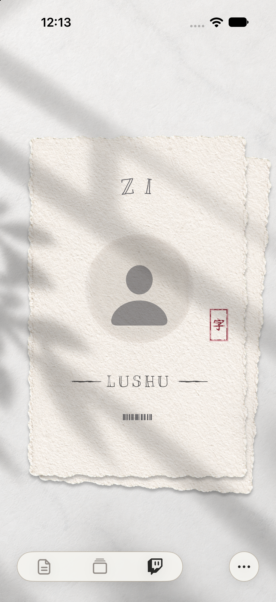

# AI Product Portfolio

周杨亚伦的 AI × 内容社区产品作品集，聚焦对人、情绪、关系与真实组织场景的理解。

> 本仓库仅用于公开展示产品界面与设计思考。完整源代码存放于私有仓库；演示内容均为虚构数据，不包含真实用户日记、学生信息、联系方式或后台账号。

## Lushu · AI 日记与人格名片

Lushu 试图把日记从“存储文本的工具”转化为理解人的媒介：通过 AI 短评、记忆卡片与人格画像，让记录者在日常表达中重新看见自己。

### 设计思考

- 以纸张、墨迹、手写字体和自然阴影降低 AI 产品的机械感。
- 不把情绪压缩成冷冰冰的标签，而是保留文字中的矛盾、迟疑和留白。
- 让 AI 以陪伴者而非裁判者的身份回应，避免过度诊断与说教。
- 将日记、短评、画像组织成连贯的自我回望路径。

### 核心界面

| 卡片总览 | 日记阅读 | 日记书写 |
| --- | --- | --- |
|  |  |  |

| 日记详情 | 人格名片 |
| --- | --- |
|  |  |

## Sufefa · 校园足球赛事平台

项目网址：[sufefa.cn](https://sufefa.cn)

面向校园足协的赛事信息与运营平台，覆盖赛程、积分、球队、球员、纪律、免锻记录和后台管理等真实组织流程。

### 产品价值

- 把分散在表格、群聊和人工通知中的赛事信息集中呈现。
- 同时服务观众、球员、球队负责人和赛事管理员等不同角色。
- 用视觉层级和一致的交互语言降低复杂赛事规则的理解成本。
- 在公开展示与组织管理之间建立权限边界，保护学生数据。

## AI 协作方式

两个项目均由我提出问题、定义场景、设计体验并主导迭代，再通过 AI 辅助完成需求拆解、代码实现、调试与文档整理。我的关注点不是“让 AI 代写”，而是如何持续判断：用户真正需要什么、界面应传达怎样的情绪，以及技术能力如何转化为可信且有人味的体验。

## 隐私说明

- 不公开项目源代码、数据库、密钥及后台账号。
- 所有 Lushu 展示日记均为虚构内容。
- Sufefa 不展示真实学生名单、学号、电话、微信或赛事后台数据。

